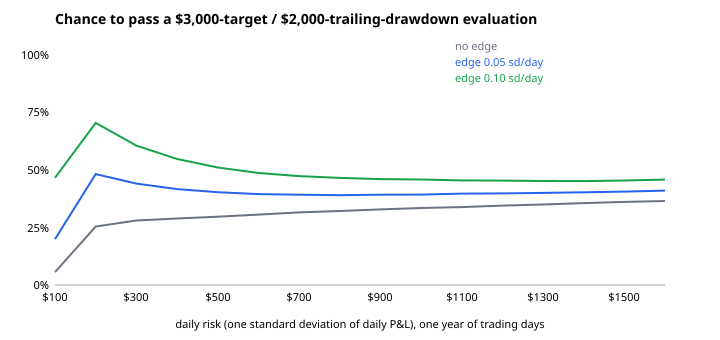

# Risk of ruin: Kelly sizing and prop-firm evaluations

Two Monte Carlo experiments on one question: **how big should each trade be?** Only needs numpy; 5 unit tests, including an exact check against the classic gambler's-ruin formula.

## 1. Kelly criterion: the cost of over-betting

A strategy that wins 45% of trades at 1.5:1 has an edge of +0.125R per trade. The Kelly fraction is p − (1−p)/b = **8.3%** of equity per trade. Simulated over 250 trades, 20,000 paths:

| × Kelly | Risk per trade | Median final equity | Growth per trade | P(drawdown > 50%) | P(end below start) |
|---|---|---|---|---|---|
| 0.25 | 2.1% | 1.72 | +0.0022 | 1.2% | 8.3% |
| 0.5 | 4.2% | 2.50 | +0.0037 | 36.3% | 12.7% |
| **1.0** | 8.3% | **3.27** | **+0.0047** | 97.2% | 22.4% |
| 2.0 | 16.7% | 0.85 | −0.0007 | 100% | 50.1% |
| 3.0 | 25.0% | 0.02 | −0.0161 | 100% | 77.5% |

- Full Kelly maximises median growth but almost always halves the account at some point.
- **Half Kelly keeps about 80% of the growth with a far smaller chance of a 50% drawdown.** That's why practitioners use fractional Kelly.
- At **2× Kelly, a winning strategy loses money**: same edge, but bet too big and the median result is below the start.

## 2. Prop-firm evaluation: pass a target before a trailing drawdown

Typical funded-trader evaluation: reach **+$3,000** before equity falls **$2,000 below its peak**. The floor trails the peak until it reaches the starting balance. Daily P&L is normal, with standard deviation = "daily risk" and mean = edge × risk; at most 250 trading days.



| Daily risk | No edge | Edge 0.05 sd/day | Edge 0.10 sd/day |
|---|---|---|---|
| $100 | 5.6% | 20.0% | 46.6% |
| $200 | 25.5% | 48.2% | **70.5%** |
| $500 | 29.7% | 40.3% | 51.1% |
| $1,000 | 33.5% | 39.3% | 45.9% |
| $1,600 | 36.5% | 41.0% | 45.8% |

**Findings**
- **With no edge, larger size looks better** (pass rate rises toward the 40% of a fixed-floor coin flip, 2,000/5,000). But that's a lottery: about two in three attempts still fail.
- **With a real edge, smaller size is better:** the edge needs many days to show up. Size up and the edge drowns in noise, so the pass rate falls back toward the no-edge level.
- Very small size fails for another reason: the target isn't reached within a year.
- A trailing drawdown is strictly harder than a fixed one with the same distance (tested).

## Run it
```bash
python3 ruin.py                               # both experiments, writes docs/pass_rate.svg
python3 -m unittest discover -s tests -v
```

## Tests
- Kelly formula on known cases
- **Gambler's ruin:** fair ±$100 bets with a fixed floor reach +$3,000 before −$2,000 with probability 2,000/5,000 = 40% (simulated within 1 point)
- Trailing drawdown pass rate < fixed drawdown pass rate on the same paths
- Kelly gives the highest median log-growth of the sizes tested
- 3× Kelly gives negative growth

## Limitations
Trades are independent with a fixed edge; real strategies have regime changes, fat tails and an edge that is only estimated. Firm rules vary (daily loss limits, consistency rules, payout buffers) and aren't modelled. Educational project, not trading advice.

## License
MIT
